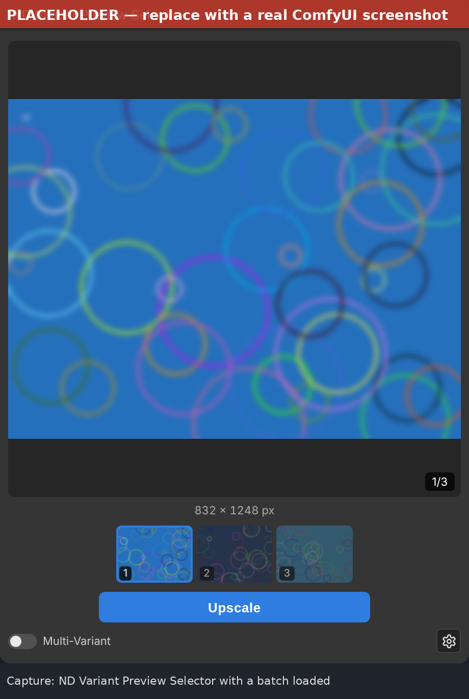
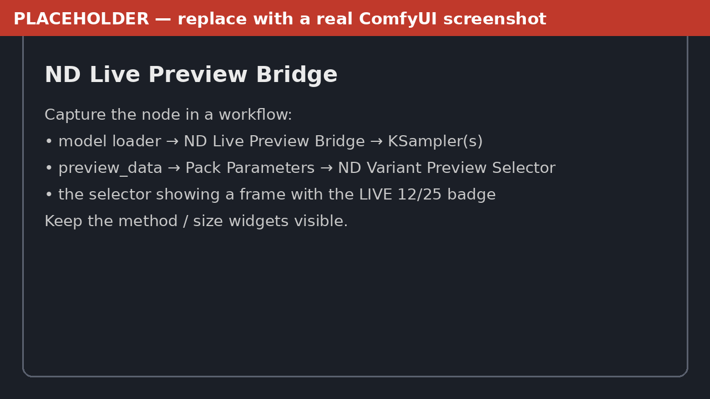
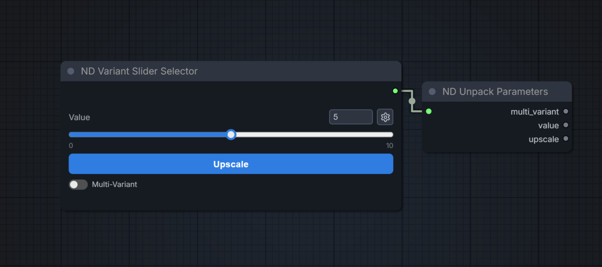
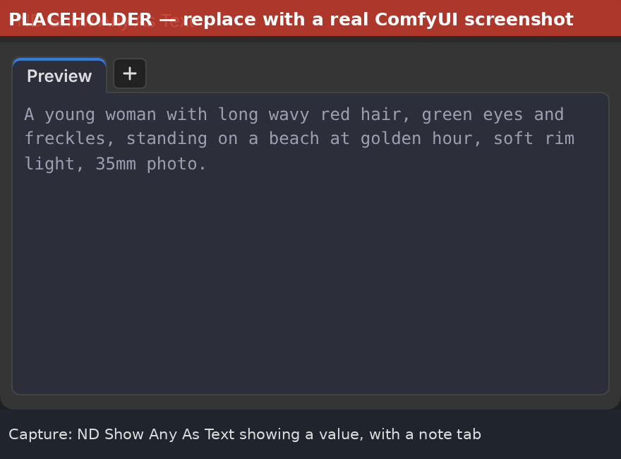
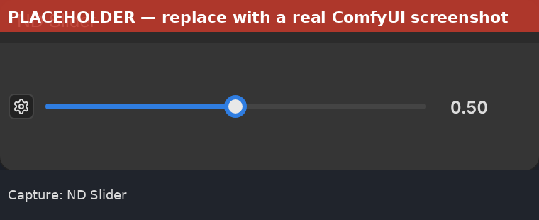
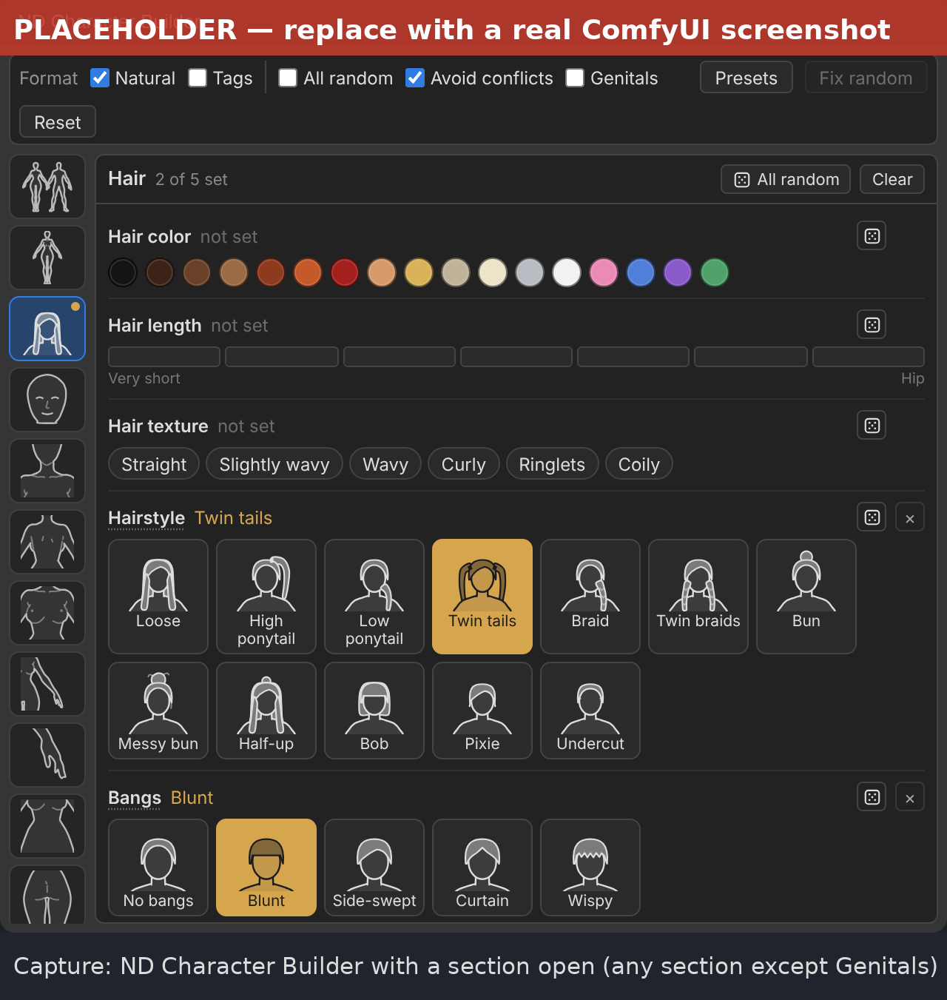
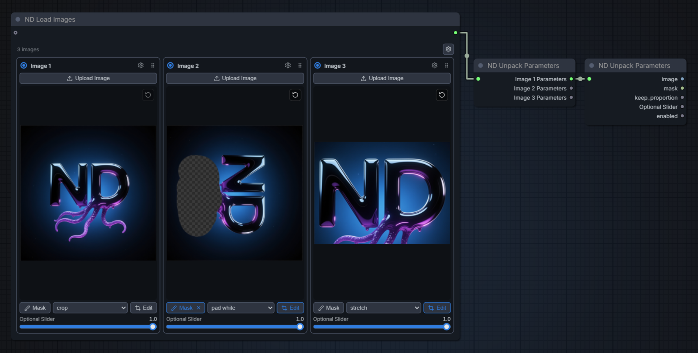
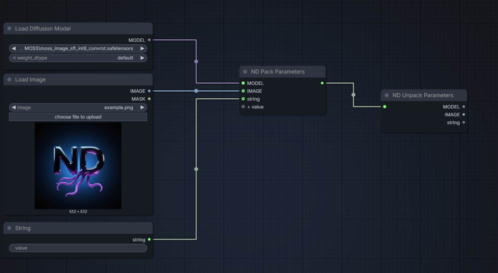

# Neural Dreamer Nodes

Custom nodes for [ComfyUI](https://github.com/comfyanonymous/ComfyUI) by Neural Dreamer.


[](LICENSE)

**English** · [Русский](README_RU.md)

## Nodes

| Node | Category | Purpose |
|---|---|---|
| [ND Variant Preview Selector](#nd-variant-preview-selector) | `Neural Dreamer/Variant` | Pick a variant from an image batch; an optional button sends it to your own upscaler |
| [ND Live Preview Bridge](#nd-live-preview-bridge) | `Neural Dreamer/Variant` | Sends a live preview of the image being generated to the Variant Preview Selector |
| [ND Variant Slider Selector](#nd-variant-slider-selector) | `Neural Dreamer/Variant` | The same control without a preview: integer slider, toggle, Upscale button |
| [ND Show Any As Text](#nd-show-any-as-text) | `Neural Dreamer/Utils` | Shows any value as text, with note tabs |
| [ND Slider](#nd-slider) | `Neural Dreamer/Utils` | A slider with a configurable range; outputs INT or FLOAT |
| [ND Character Builder](#nd-character-builder) | `Neural Dreamer/Prompt` | Character Prompt Builder |
| [ND Load Images](#nd-load-images) | `Neural Dreamer/Images` | 1–20 image blocks with upload, mask, crop/rotate/flip, Keep Proportion and a slider |
| [ND Pack Parameters](#nd-pack-parameters--nd-unpack-parameters) | `Neural Dreamer/Parameters` | Packs any values into one wire |
| [ND Unpack Parameters](#nd-pack-parameters--nd-unpack-parameters) | `Neural Dreamer/Parameters` | Opens a parameters wire into separate outputs |
| [ND Multi Switch](#nd-multi-switch) | `Neural Dreamer/Logic` | Switches whole groups of values at once: true / false pairs, one output per pair |
| [ND Any Switch](#nd-any-switch) | `Neural Dreamer/Logic` | Passes on one of many inputs of any type, picked by an index; only that one runs |
| [ND ON / OFF](#nd-on--off) | `Neural Dreamer/Logic` | Passes a value through or drops it, as if the wire did not exist |

## Installation

Clone the repository into `ComfyUI/custom_nodes` and restart ComfyUI:

```bash
cd ComfyUI/custom_nodes
git clone https://github.com/neural-dreamer/ComfyUI-NeuralDreamer-Nodes.git
```

No additional Python dependencies are required.

## Connecting the nodes

Nodes that take or give several values have at most one input and one output, both of type `ND_PARAMS` (a parameters wire) and drawn without a name. Values go in and out through **ND Pack Parameters** and **ND Unpack Parameters**. ND Show Any As Text and ND Slider work with a single plain value and connect directly.

- Connect a Pack to a node's input and the Pack shows exactly the inputs that node expects (for example `images` and `image` for the Variant Preview Selector).
- Connect an Unpack to a node's output and the Unpack shows that node's outputs, named and typed.
- When a parameters wire is dragged out into empty space, Pack (from an input) or Unpack (from an output) is the first suggestion in the node search.
- A field can itself be a parameters wire; open it with another Unpack.

## ND Variant Preview Selector



Shows an image batch as thumbnails with a main preview. Select a variant with a click or the arrow keys.

**This node is not an upscaler** and does not upscale anything itself. The **Upscale** button is optional (it can be turned off in the settings) and has another purpose: it sends the selected variant to an upscaler you build in the workflow after the selector, with any upscale nodes, including third-party ones. The generation is reused from cache, and the upscaled result can be shown back in the node.

**Input fields** (through Pack Parameters)

| Field | Type | Description |
|---|---|---|
| `images` | IMAGE | Batch of variants |
| `image` | IMAGE, optional | Upscaled result, shown back in the node. Not evaluated on a normal Run |

**Output fields** (through Unpack Parameters)

| Field | Type | Description |
|---|---|---|
| `multi_variant` | BOOLEAN | State of the Multi-Variant toggle |
| `selected_index` | INT | Index of the selected image, starting at 0 |
| `upscale` | BOOLEAN | `true` only for a run started by the Upscale button |

**Interface**

- Thumbnail strip and main preview with a position badge (`2/4`). Variants are numbered from 1 in the interface; `selected_index` is the 0-based index, so variant 1 outputs `0`.
- Main preview on top, under it the size of the shown image (`1024 × 1536 px`; while comparing, both sizes), then the thumbnails and the **Upscale** button. The button is available while a variant from the batch is shown.
- **Multi-Variant** toggle at the bottom left. Its label can be renamed in the settings (*Toggle label*); this changes only the text in the node, the output is still `multi_variant`.
- **Compare** appears on the upscaled result and switches a before/after slider between the image sent to upscale and the result.
- The gear button opens the settings: file names, saving, the Upscale button and the live preview.
- **Live preview** (off by default, in the settings): while the variants or the Upscale pass are generated, the main preview shows the sampler frames, with a `LIVE 12/30` badge (sampler steps). The eye button at the bottom left of the preview hides or shows them in this node. It always shows the image being generated right now (with several samplers, the one running; with a batch, its first image); the thumbnails keep the last results until the new ones arrive. With an [ND Live Preview Bridge](#nd-live-preview-bridge) in front of the samplers the frames come from the bridge and ComfyUI's own sampler preview is turned off for that run, also while the eye hides the live preview. Without a bridge the node shows ComfyUI's own previews: they must be on (Settings → Comfy → Execution → Live preview method).
- The mouse wheel over the node zooms the canvas, and dragging with the middle button pans it. If the thumbnails do not fit, scroll the strip with Shift+wheel or a horizontal trackpad swipe.

**Saving**

| Setting | Description |
|---|---|
| Toggle label | Text next to the toggle, `Multi-Variant` by default. Only for the node interface |
| File name | Common start of the file names, `ND_Image` by default. Subfolders such as `shots/hero` are supported |
| Variant name | Added after the file name for the variants: `ND_Image_variant`. Empty saves them under the file name alone |
| Upscaled name | Added after the file name for the upscaled result: `ND_Image_upscaled` |
| Upscale button | Shows the Upscale button (on by default). When it is off, every incoming batch is saved |
| Save variants | Saves the incoming batch to the `output` folder on every normal Run. Always on while the Upscale button is off |
| Live preview | Shows the sampler's frames in the node while it runs (off by default). Only for the node interface |

Files are numbered like those of the stock Save Image node: `ND_Image_variant_00001_.png`. The upscaled image is always saved. Workflows saved with the old default name `ND_variant` switch to `ND_Image` when loaded. Workflow metadata is embedded as with the stock Save Image node. While the browser tab stays open, the node keeps its images when you switch to another workflow tab and back, along with the selected variant and the upscaled result; a run that finished in the meantime is picked up too. After a page reload or a ComfyUI restart the node is empty until the next Run, and a reloaded workflow starts at variant 1.

## ND Live Preview Bridge



Goes on the `MODEL` wire in front of the samplers (after the model loader and its patches, e.g. LoRAs or ModelSampling). While they run, it sends a small preview of the image being generated (the first one of a batch) to [ND Variant Preview Selector](#nd-variant-preview-selector) with *Live preview* on. The model passes through unchanged.

| Input / output | Description |
|---|---|
| `model` → `model` | The model, with a hook that reads each sampler step |
| `preview_data` | Link to one selector: plug it into the Pack that feeds the selector (the Pack shows a `preview_data` pin for it). A selector fed by images made with the bridge gets the frames without it too |
| method | `latent2rgb` (fast, rough colours) or `taesd` (sharper; needs the TAESD decoder in `models/vae_approx` and a little GPU time) |
| size | Longer side of the frames, 384 px by default |

- Frames are sent only while a selector fed by the bridge has *Live preview* on and shown; turning it on or off never re-runs the sampling.
- It works whatever ComfyUI's Live preview method is, and through subgraphs.

## ND Variant Slider Selector



Integer slider with a Multi-Variant toggle and an Upscale button. Like the Preview Selector, it does not upscale anything itself: the button only starts the upscale branch you build in the workflow. It has no input. The slider range (min, max, step) is set with the gear button or in the node properties.

| Output field | Type | Description |
|---|---|---|
| `multi_variant` | BOOLEAN | State of the Multi-Variant toggle |
| `value` | INT | Slider value |
| `upscale` | BOOLEAN | `true` only for a run started by the Upscale button |

## ND Show Any As Text



Accepts any type on the `value` input and shows it as text.

| Value | Shown as |
|---|---|
| String | As is |
| Number, boolean | The value |
| List, dict (latent, conditioning, ...) | Formatted JSON |
| Tensor, array (image, mask, ...) | Shape, dtype and min/max/mean; values only for very small tensors |

A list input (several items) is shown item by item. Output is limited to 100,000 characters.

**Tabs**

- **Preview** is the first tab and is open by default. It has a lighter background and muted text (note tabs have a darker background and brighter text), is read-only, and its text can be selected and copied.
- **+** adds a note tab (`Note 1`, `Note 2`, ...). Double-click a tab title to rename it.
- The × button deletes a note tab. A tab with text asks for a second click.
- Notes and the last preview text are saved in the workflow and stay after reloading the workflow or ComfyUI. The preview changes only when new input data arrives.
- Canvas navigation over the node works as with the Variant Selector. The wheel scrolls a text area only when its text does not fit; otherwise, and with Ctrl, it zooms the canvas.

## ND Slider



A one-row slider across the whole node, always centred vertically. The gear on the left opens the settings; the output pin is on the right, level with the slider. No inputs.

| Setting | Description |
|---|---|
| Type | `Integer` or `Float`. Sets the output type: INT or FLOAT |
| Min, Max | Range of the slider |
| Step | Slider step. For integers it is rounded and at least 1 |

- The current value is shown to the right of the slider; click it to type a value. The node is one row high, like the stock widgets.
- When the type changes, wires to inputs that do not accept the new type are removed.
- The value and settings are saved in the workflow.

## ND Character Builder



Character Prompt Builder. On the left is a column of section buttons with icons drawn from reference figures: General (woman and man), Whole body, Hair, Face, Neck, Shoulders & Back, Chest, Arms, Hands & Nails, Waist, Hips & Butt, Legs, Feet, Genitals. A button opens the section's parameters on the right; hover it to see what is set there. Hairstyles, bangs and nail shapes are chosen from pictures. Input: an optional `ND_PARAMS` wire with the field `seed`; connect a Pack Parameters and put a seed into it (for example from a seed node). The node has no seed widget of its own; without the wire the seed is 0, so random values stay the same from run to run.

| Part | Parameters |
|---|---|
| General | Sex, age (18–90), race (human or fantasy: elf, dark elf, half-elf, dwarf, gnome, halfling, goblin, orc, half-orc, tiefling, demon, succubus, incubus, angel, vampire, oni, fairy, cat-, fox-, wolf- and bunny-folk, dragon-kin), appearance, skin tone (including green, grey, blue, red and purple, each in a regular and a dark shade, for fantasy races), skin texture |
| Face | Face shape, eye size, shape and color, eyebrows, nose, lips, mouth, jaw, chin, cheekbones |
| Hair | Color, length, texture, hairstyle, bangs |
| Body | Height, figure, body fat, neck, shoulder width, arm and leg length |
| Muscle | Overall muscle, with separate values for arms, back and shoulders, abs, glutes and legs |
| Waist & Hips | Waist, belly, hip width |
| Chest | Ribcage; for women breast size, shape and firmness; for men pecs and chest hair; areola size and color, nipple size and shape |
| Butt & Legs | Butt size, shape and firmness, thigh size and shape, thigh gap, calves |
| Hands & Nails | Hand size, finger length and thickness, nail type, length, shape, color and finish |
| Feet | Foot size and width, arch, toe length, pedicure color and finish |
| Genitals | Anatomy settings (adult characters only, hidden by default) |

- The Genitals section is hidden by default. Tick *Genitals* on the toolbar to show it; while it is off, none of its values are used (workflows that already have values there open with it on). It is meant for fictional adult characters (18+) only and must not be used to depict real people; a short notice says so when it is switched on.
- A dot on a section button shows that it has values: gold for set values, violet for random ones.
- Hover a value or an underlined parameter name for a description of what it means.
- Parameters for one sex (breasts for women, pecs and chest hair for men) are hidden while the other sex is chosen and left out of the text; their values are kept for when the sex changes back.
- Some choices switch other parameters off: a flat chest drops the breast shape and firmness, a French manicure or bare or clear nails drop the nail color. The panel shows such parameters as not used.
- *Same as hands* (in Feet) copies the nail color and finish to the pedicure.
- Each parameter is *not set* (left out of the text), set to a value, or random. Click a chosen value again to clear it; × clears it too.
- **Random** (dice button): the value is picked with the `seed` from the input wire on every run. Each parameter gets its own draw, so fixing one parameter does not change the others. While random is on, click the values to choose which ones it may pick; for age, set the range. *All random* sets the whole zone to random.
- **All random** (toolbar): every parameter of every section becomes random at once. Clicking values still narrows what random may pick. The values you set by hand are kept and come back when it is turned off; *Fix random* turns the last picked character into fixed values and switches it off.
- **Race** takes up to three values at once to mix races: click Elf and Fox-folk and the character is described as "of mixed elf and fox-folk blood", with the features of both (pointed ears, fox ears, a tail) and the tags of both. A fourth click is refused (the row shakes); click a chosen race again to remove it. Random picks one race.
- Random picks Human about as often as all fantasy races together, and the fantasy skin colors only for races that suit them (green skin for orcs and goblins, red for tieflings and demons, and so on).
- **Avoid conflicts**: random picks skip values that clash with the others, for example a pixie cut with waist-length hair, wrinkled skin at 25, or chubby with a six-pack. Values you set yourself are never changed.
- **Fix random** turns the last picks into fixed values, so a character you like can be edited by hand.
- **Presets**: type a name and press *Save* to keep every setting of the node (all parameters, random choices and their pools, formats and Avoid conflicts). Click a preset to load it; it replaces the current settings. × deletes a preset (click again to confirm). Saving under an existing name overwrites it. Presets are stored in the ComfyUI user folder (`user/<user>/neural_dreamer/character_presets.json`), so every workflow sees them.
- **Format**: *Natural* (sentences, for Flux 2 and Krea 2) and *Tags* (comma-separated tags: Danbooru tags such as `1girl`, `long hair`, `wide hips` wherever Danbooru has one, plain tags such as `heart-shaped face`, `slavic appearance`, `27 years old` for the rest). Both can be on; at least one always is.
- Age is limited to 18–90 in the browser and again on the server.
- Output: one `ND_PARAMS` wire. Unpack Parameters opens it into `Description` (the whole character) and one text per part: `General`, `Face`, `Hair`, `Body`, `Muscle`, `Waist & Hips`, `Chest`, `Butt & Legs`, `Hands & Nails`, `Feet`, `Genitals`, and `Negative` (tags of the anatomy the character does not have; empty until the Genitals section is set). A part with nothing set gives an empty string.
- The wording lives in `js/character_builder.json` and can be edited; the server reloads it when the file changes (reload the page to update the panel).
- Everything is saved in the workflow, including the open section and the last random picks shown in the panel.

## ND Load Images



A modular image loader. The number of blocks (1–20) is set in the node settings (gear at the top right); there are no add/remove buttons on the node itself. Blocks are laid out in a grid that adapts to the node size.

**Block**

- **Upload Image** opens the file dialog; an image can also be dropped onto the block. A new block starts with `example.png` from the input folder.
- **Mask** opens the ComfyUI mask editor for the block's image. A block without a mask outputs an empty mask. The × on the button removes the mask.
- **Keep Proportion**: `crop`, `pad white`, `pad black`, `pad edge` (repeats the edge pixels), `pad edge color` (fills each side with the average color of the image edge next to it), `stretch` (default `crop`).
- **Edit** opens an editor to crop, rotate and flip the image. Edits are non-destructive and can be changed later.
- The round-arrow button in the top right corner of the image resets the block to `example.png` and removes the mask, rotation, flip and crop.
- **Slider**: name, min, max and step are set in the block settings (default `Strength`, 0.0–1.0, step 0.1).
- The circle at the top left enables or disables the block; a disabled block is shown faded.
- Drag the grip at the top right to change the order of the blocks. A block with *Lock Order Position* shows a lock instead and keeps its place.

**Block settings** (gear in the block header): *Block name*, a title for the block (empty means `Image N`; it is only a label for the interface, stored in the workflow, and a block keeps its name when blocks are reordered; the matching Unpack output shows it as `<name> Parameters`); show or hide the Mask button, the Keep Proportion selector and the slider; whether Keep Proportion changes the image or is only passed to the output; the scaling method for that resize (`nearest-exact`, `bilinear`, `area`, `bicubic`, `lanczos`; default `lanczos`); slider name, range and step; *Lock Order Position*: the block cannot be dragged, and when other blocks are reordered they move around it. A disabled option is also removed from the block's outputs (the mask output is always present).

**Node settings**: number of blocks; *Hide block settings* hides the block gears so a finished setup is not changed by accident.

**Processing order** for each block: mask (drawn on the original image) → rotate → flip → crop → Keep Proportion to the target size with the block's scaling method, if the block applies it. The target size is `width` and `height` from the input; without them it is the size of the first enabled block's image after its edits, so the other blocks are fitted to it. With no enabled block nothing is resized. Pad modes pad the mask with 0 (`pad edge` repeats its edge).

| Side | Fields | Description |
|---|---|---|
| Input (optional) | `width`, `height` (INT) | Target size for every block. Connect a Pack Parameters; it creates both inputs. Without it the first enabled image sets the size |
| Output | `Image N Parameters` | One field per block. Unpack a block's field into `image`, `mask`, `keep_proportion`, the slider value and `enabled` |

All settings, files, masks and edits are stored in the workflow.

## ND Multi Switch

Switches whole groups of values at once. The inputs come in pairs, `true N` and `false N`, with one output per pair. The `condition` toggle picks the side the outputs are taken from: `out N` is `true N` when it is on and `false N` when it is off.

- A new pair appears as soon as the last one is connected (up to 32). Thin lines separate the pairs.
- Every pair has its own data type, set by the first wire connected to it on either side: to a `true` or `false` input, or to the output. The three pins of the pair then share that type and are named after the pin at the other end of the wire (`image (true)`, `image (false)`, `image (out)`). A pair with no wires left is free again (`true +`, `false +`, `out`). An empty pair between used ones stays, so the output numbers never move. A name typed with Rename Slot is kept.
- Only the selected side is evaluated: nodes that feed the other side are not run for the switch.
- If the selected side of a pair has nothing connected while the other side has, that output blocks the nodes after it: they are skipped, without an error.

## ND Any Switch

Passes on one of its inputs. The integer `index` picks which one (1 is the first pin); the pin it points at is highlighted.

- Starts with two pins: the first, and a free one marked `+`. A new `+` pin appears as soon as the last one is connected (up to 64). Every pin accepts any type, independently of the others; a connected pin is named `N: <source name>`.
- The single output has a free type and can be connected to any pin.
- Only the picked input is evaluated, the others are ignored as if their wires led nowhere. With several model loaders connected, only the picked one runs.
- If the picked pin is empty, the output is empty too, without an error.

## ND ON / OFF

Passes one value through. With the `condition` toggle on (true) the value goes to the output; with it off (false) nothing comes out, as if the wire after the node did not exist: an optional input fed by it counts as not connected, not as missing data. The input is not evaluated while it is off.

- One input and one output. The first wire connected, to the input or to the output, gives both pins its type and name.

**How the two Logic switches empty a wire.** When the `index` or `condition` is set in the node (or comes from a Primitive Int / Primitive Boolean node), the browser removes the switch from the prompt it sends: the nodes after it are wired straight to the picked source, or lose that wire altogether. When it comes from any other computed value, the node stays in the prompt and outputs `None` for "nothing". A required input after an empty output is reported by ComfyUI as missing, as for any unconnected wire. Export (API) gives the same resolved prompt.

## ND Pack Parameters / ND Unpack Parameters



A parameters wire (`ND_PARAMS`) carries several named values at once, and wires can be nested.

- **ND Pack Parameters**: when its output goes into a node of this pack, it shows the inputs that node expects, with their names and types. Otherwise it accepts any values: a new input appears when the last one is connected, each field is named after the connected output, and renaming an input renames its field. Optional inputs are drawn as hollow circles: every input after the first, including `+ value`, or the fields the connected node marks optional.
- **ND Unpack Parameters**: connect a parameters wire and the outputs are created automatically, named and typed after the fields. A field that is itself a parameters wire (for example `Image 1 Parameters`) is opened with another Unpack.
- Both follow wires through reroutes and subgraph boundaries.

## How Upscale works

The selectors do not upscale. The Upscale button only queues a run with `upscale = true`; what happens with the selected image is up to the upscale branch you connect (any upscale nodes, including third-party ones).

- **Run** queues the workflow with `upscale = false`. The wire into the `image` field of the selector's Pack is removed from the prompt, so the upscale branch is not evaluated.
- **Upscale** queues the workflow with `upscale = true` and the index selected at the moment of the click. Seeds set to randomize or increment on nodes upstream of the selector keep their values from the last Run, so the generation is taken from cache. The result wired to `image` is saved and shown in the node.
- The selector's output reaches other nodes through an internal helper node (ND Variant Values) that holds the values shown in the selector when the run is queued. Nothing downstream depends on the selector itself, so its output and input can be routed through the same subgraph or a Pack/Unpack round trip without a circular connection error.
- Gate the upscale branch with the `upscale` field (for example through a switch node).

## Adding nodes

Each node lives in its own module in `nd_nodes/`. Register a new module by adding its name to `MODULES` in `nd_nodes/__init__.py`. Frontend code goes into `js/`.

New nodes that pass several values follow the same convention: one `ND_PARAMS` input named `params` and one `ND_PARAMS` output named `params`, both drawn without a label. To let Pack and Unpack build pins for a node, register its fields in the browser through the shared registry in `js/nd_common.js` (`ND_REG.consumers` for the input, `ND_REG.providers` for the output). Keep class keys longer than `NDUnpack`: the node search ranks nodes of the same type by their shortest name, and the short keys `NDPack` / `NDUnpack` are what keep Pack and Unpack on top. Internal helper nodes set `DEV_ONLY = True` so they stay out of the search.

```text
ComfyUI-NeuralDreamer-Nodes/
├── __init__.py
├── nd_nodes/
│   ├── __init__.py
│   ├── variant_selector.py
│   ├── live_preview.py
│   ├── multi_switch.py
│   ├── switches.py          # Any Switch, ON / OFF
│   ├── show_any_text.py
│   ├── load_images.py
│   ├── slider.py
│   ├── character_builder.py
│   └── params.py
├── js/
│   ├── nd_common.js        # shared UI helpers (canvas zoom/pan over node UIs)
│   ├── variant_selector.js
│   ├── show_any_text.js
│   ├── load_images.js
│   ├── slider.js
│   ├── multi_switch.js
│   ├── switches.js
│   ├── nd_wires.js         # helpers for pins that follow the type and name of their wires
│   ├── character_builder.js
│   ├── character_builder.json  # parts, options and wording of the Character Builder
│   ├── character_icons.js  # Character Builder icons (generated by tools/make_character_icons.py)
│   └── params.js
├── tools/  # dev scripts, not loaded by ComfyUI
└── docs/
    └── images/
```

## Links

[YouTube](https://www.youtube.com/@neural_dreamer) ·
[VK Video](https://vkvideo.ru/@neural_dreamer) ·
[Boosty](https://boosty.to/neural_dreamer) ·
[Patreon](https://www.patreon.com/cw/neural_dreamer) ·
[Civitai](https://civitai.red/user/Neural_Dreamer) ·
[Hugging Face](https://huggingface.co/NeuralDreamer)

Bug reports and suggestions: [Issues](https://github.com/neural-dreamer/ComfyUI-NeuralDreamer-Nodes/issues).

## License

[MIT](LICENSE) © Neural Dreamer
